# Operator Development Process

An Operator is a project introduced by CoreOS designed to simplify the management of complex stateful applications. It is a controller that perceives application state by extending the Kubernetes API to automatically create, manage, and configure application instances. Operators extend resource objects based on Custom Resource Definitions (CRDs) and use controllers to ensure applications remain in their desired state.

* Observe the current cluster state via the Kubernetes API;

* Analyze the differences between the current state and the desired state;

* Call the Kubernetes API to reconcile these differences.

## Why Use CRDs?

Kubernetes has become one of the most popular open-source projects in the cluster scheduling domain. Its built-in controllers generally satisfy most use cases, but their expressiveness is limited for many customized requirements. Therefore, Kubernetes supports Custom Resource Definitions, commonly referred to as CRDs. Through this feature, users can define their own resource types, which Kubernetes will treat as a type of resource, providing them with support similar to built-in resource objects, making the implementation more native. CRDs can significantly enhance Kubernetes' extensibility, implementing customized requirements in a more native way.

## Original Intent of Operator Design

When managing applications, we encounter both stateless and stateful applications. Managing stateless applications is relatively straightforward, but stateful applications are more complex. The Operator's design aims to simplify the management of complex stateful applications by extending the Kubernetes API via CRDs to automatically create, manage, and configure application instances. Essentially, it is a tool tailored for specific scenarios to provide stateful services, or to simplify the operations and maintenance of complex application scenarios. 

Operators are deployed to Kubernetes in the form of Deployments. Once the Operator is deployed, deploying a cluster becomes very convenient. There is no need to manage the cluster's configuration information manually; you only need to create a CRD, specify the number of nodes and the required version, and the Operator will watch that resource object to create a cluster that meets the configuration requirements, thereby greatly reducing the difficulty and cost of operations.


**The general workflow for developing Operators for different middleware is largely the same. The following explanation uses the Redis Operator as an example:**


## Preparation

- Need a resource object definition (CRD) YAML file. The Operator code will use this YAML to assemble and create the CRD.

```yaml
apiVersion: apiextensions.k8s.io/v1beta1
kind: CustomResourceDefinition
metadata:
  name: redisclusters.redis.middleware.hc.cn
spec:
  group: redis.middleware.hc.cn
  version: v1alpha1
  scope: Namespaced
  names:
    kind: RedisCluster
    singular: rediscluster
    listKind: RedisClusterList
    plural: redisclusters
    shortNames:
    - rec
```

​     The `kind` value of the resource object (CR) created later for this CRD type corresponds to the value of `spec.names.kind` in the above YAML. The CR is the concrete implementation of the CRD. (Different Operators have different CRD/CR definitions);


- Prepare a CR YAML file. The Operator code will later define the structure in `types.go` based on this YAML structure. The Redis CR YAML is as follows. The Operator will ultimately watch this CR, parse parameters like the number of nodes and version defined inside, and drive necessary actions.

```yaml
apiVersion: redis.middleware.hc.cn/v1alpha1
kind: RedisCluster
metadata: 
  name: example000-redis-cluster
  namespace: kube-system
spec:
  # Number of redis cluster nodes
  replicas: 7
  # Whether to enter maintenance/pause mode
  pause: true
  # Whether to delete the CRD and redis cluster
  finalizers: foreground
  # Image repository
  repository: library/redis
  # Image version, to facilitate future multi-version specialization support
  version: 3.2.8
  # Redis cluster upgrade strategy
  updateStrategy:
    # Upgrade type: AutoReceive (auto-assigned, no need for AssignStrategies), AssignReceive (assign specific values, requires AssignStrategies)
    type: AssignReceive
    pipeline: "100"
    assignStrategies:
       - 
        slots: 2000
        fromReplicas: nodeId1
       - 
        # Allocate 1000 slots from nodeId3 and nodeId4
        slots: 1000 
        # Separate multiple nodeIds with commas
        fromReplicas: nodeId3,nodeId4
  # Redis instance configuration details
  pod:
    # Label management: map[string][string]
  - labels:
      key: value
    # Annotation management: map[string][string]
    annotations:
      key: value
    # Environment variable management
    env:
    - name: tony
      value: aa
    - name: MAXMEMORY
      value: 2gb    
    # Affinity management
    affinity: 
      nodeAffinity:
      requiredDuringSchedulingIgnoredDuringExecution:
        nodeSelectorTerms:
        - matchExpressions:
          - key: HarmonyCloud_Status
            operator: In
            values:
            - C
      podAntiAffinity: {}
    # Resource management
    resources:
      limits: 
        # cpu, memory, storage, ephemeral-storage
        cpu: "2"
        memory: 4Gi
      requests:
        cpu: "1"
        memory: 2Gi
    # StatefulSet update strategy
    updateStrategy:
      type: RollingUpdate
    # Supported mount types: hostPath (does not require persistentVolumeClaimName), nfs (requires persistentVolumeClaimName)
    volumes:
      type: nfs
      persistentVolumeClaimName: pvcName
    # ConfigMap template name
    configmap: name
    # Monitoring image
    monitorImage: string
    # Init container image
    initImage: string
    # Middleware container image
    middlewareImage: string

status:
  # Current StatefulSet replicas status
  replicas: 6
  # Cluster phase: None, Creating, Running, Failed, Scaling
  # None or "", indicates the CRD was just created
  # Creating indicates waiting for Redis resources to be created (Operator detects CRD creation, creates resource objects, updates status)
  # Running indicates initialization has started (after Creating, after instances are up, initialization begins)
  # Failed indicates an abnormal fault
  # ---------------------
  # Scaling indicates instance inconsistency (User modified instance count, Operator detects inconsistency, updates StatefulSet, updates status)
  # Upgrading indicates upgrade in progress
  # ---------------------
  phase: Creating
  # Explanation of abnormal issues
  reason: "Abnormal Issue"
  conditions:
  - name: redis-cluster-0
    instance: 10.168.78.90:6379
    type: master
    masterNodeId: allkk111snknkcs
    nodeId: allkk111snknkcs
    domainName: redis-cluster-0.redis-cluster.kube-system.svc.cluster.local
    slots: 1024-2048
    hostname: docker-vm-3
    hostIP: 192.168.26.122
    # true or false
    status: "True"
    reason: xxxx
    message: xxxx
    lastTransitionTime: 2019-03-25T03:10:29Z
```


## Code Generation

Mainly generates code that conforms to the Kubernetes style:

* Generate uniformly styled `DeepCopy` methods (CustomResources must implement the `runtime.Object` interface—meaning they must implement the `DeepCopy` method);

* `clientset` (client for custom resource objects);

* `listers` (provides a read-only cache layer for GET/List requests on resource objects);

* `informers` (List/Get resource objects, can also listen for events and trigger callback functions).

  

Structure definitions are placed in `$ProjectName/pkg/apis/{middleware_name}/{version}/types.go`:

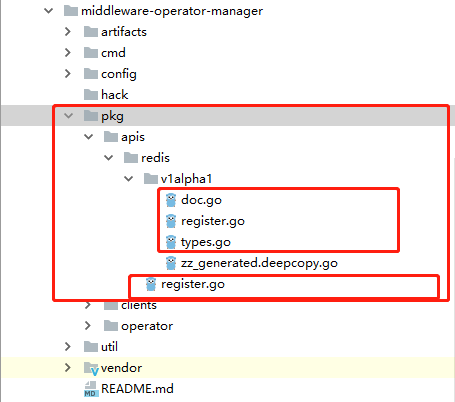


The structure definition in `types.go` is based on the CR YAML prepared above. Note that the following two annotations must be added to the structure:

* `// +k8s:deepcopy-gen:interfaces=k8s.io/apimachinery/pkg/runtime.Object` annotation indicates: Generate `func (t *T) DeepCopy() *T` method for this type. All API types need to implement deep copying;
* `// +genclient` annotation indicates that a client will be generated for the current type.

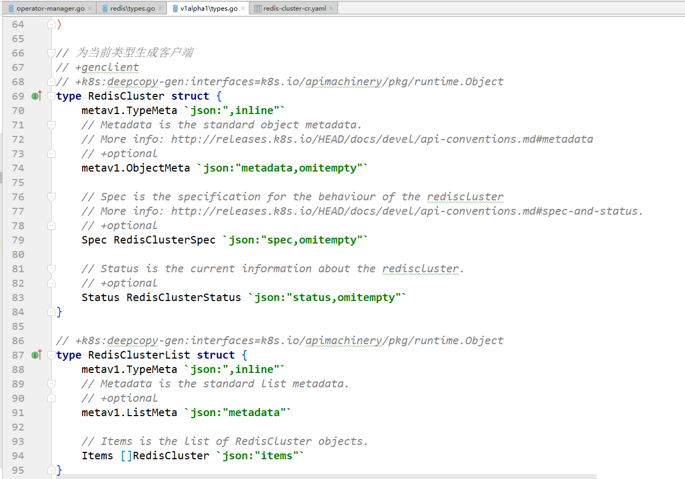


3. Write `$ProjectName/pkg/apis/{middleware_name}/{version}/doc.go`, which defines the global tag: `// +k8s:deepcopy-gen=package`, indicating that deep copy methods will be generated for any type in the package. The `package` specifies the version.

4. Write `$ProjectName/pkg/apis/{middleware_name}/{version}/register.go`, which registers the custom CR type via the scheme, allowing it to be handled when communicating with the API Server. (Different Operators need to modify the `Group` and `Version` of `SchemeGroupVersion` and the registered structures in `addKnownTypes`)

```go
package v1alpha1

import (
	"harmonycloud.cn/middleware-operator-manager/pkg/apis/redis"
	v1 "k8s.io/apimachinery/pkg/apis/meta/v1"
	"k8s.io/apimachinery/pkg/runtime"
	"k8s.io/apimachinery/pkg/runtime/schema"
)

// SchemeGroupVersion is group version used to register these objects
var SchemeGroupVersion = schema.GroupVersion {Group: redis.GroupName, Version: "v1alpha1"}

// Kind takes an unqualified kind and returns back a Group qualified GroupKind
func Kind(kind string) schema.GroupKind {
	return SchemeGroupVersion.WithKind(kind).GroupKind()
}

// Resource takes an unqualified resource and returns a Group qualified GroupResource
func Resource(resource string) schema.GroupResource {
	return SchemeGroupVersion.WithResource(resource).GroupResource()
}

var (
	SchemeBuilder = runtime.NewSchemeBuilder(addKnownTypes)
	AddToScheme   = SchemeBuilder.AddToScheme
)

// Register CR objects
// Adds the list of known types to Scheme.
func addKnownTypes(scheme *runtime.Scheme) error {
	scheme.AddKnownTypes(SchemeGroupVersion,
		&RedisCluster{},
		&RedisClusterList{},
	)
	v1.AddToGroupVersion(scheme, SchemeGroupVersion)
	return nil
}
```

5. Write `$ProjectName/pkg/apis/{middleware_name}/register.go`, which defines the `GroupName` used in the previous step;

6. Use the `code-generator` tool provided by Kubernetes to generate uniformly styled `DeepCopy` methods (CustomResources must implement the `runtime.Object` interface—meaning they must implement the `DeepCopy` method), `clientset` (client for custom resource objects), `listers` (read-only cache layer for GET/List requests), and `informers` (List/Get resource objects, listen for events, and trigger callbacks) based on the defined CR structure object.

The `code-generator` address is as follows. After downloading, place it in the `$GOPATH/src/k8s.io/` directory:

<https://github.com/kubernetes/code-generator> 

Then execute the following command. `harmonycloud.cn/middleware-operator-manager/pkg/clients` indicates the final directory for the generated `clientset`, `informers`, and `listers` code. The final `redis:v1alpha1` needs to be changed to `{middleware_name}:{version}`.

```sh
./generate-groups.sh all "harmonycloud.cn/middleware-operator-manager/pkg/clients" "harmonycloud.cn/middleware-operator-manager/pkg/apis" "redis:v1alpha1"
```

After execution, the following code will be generated:

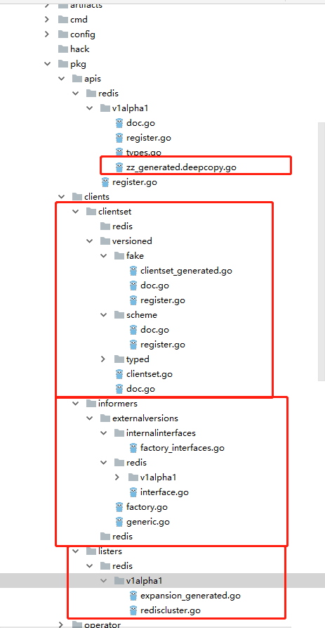


References:

[Extend Kubernetes with Custom Resources](<https://blog.gmem.cc/extend-kubernetes-with-custom-resources> )

[Extending Kubernetes: Create Controllers for Core and Custom Resources](<https://medium.com/@trstringer/create-kubernetes-controllers-for-core-and-custom-resources-62fc35ad64a3> )


## Operator Main Flow Code Development


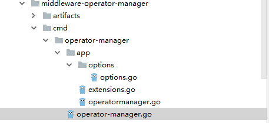

First, the entry point of the Operator is the `main` function in `operator-manager.go`.

```go
package main

import (
	"fmt"
	"github.com/spf13/pflag"
	"harmonycloud.cn/middleware-operator-manager/cmd/operator-manager/app"
	"harmonycloud.cn/middleware-operator-manager/cmd/operator-manager/app/options"
	"k8s.io/apiserver/pkg/util/flag"
	"k8s.io/apiserver/pkg/util/logs"
	"k8s.io/kubernetes/pkg/version/verflag"
	"os"
)

func main() {
    // Parameter initialization configuration
	s := options.NewOMServer()
	s.AddFlags(pflag.CommandLine, app.KnownOperators())

	flag.InitFlags()
    // Log initialization
	logs.InitLogs()
	defer logs.FlushLogs()

	verflag.PrintAndExitIfRequested()
	// Initialize Operator
	if err := app.Run(s); err != nil {
		fmt.Fprintf(os.Stderr, "%v\n", err)
		os.Exit(1)
	}
}
```

In the `main` function, parameter initialization is performed first, which mainly includes: leader election configuration for multi-instance Operators; event synchronization time; cluster creation and upgrade timeout durations; whether to enable leader functionality; whether to enable pprof analysis, etc. The code is in `options.go`.

`app.Run(s)` initializes the Operator based on parameter configurations:

* First, based on parameter configurations, build default clients (for operating existing k8s resource objects), leader election clients, and extended resource clients, etc.;
* Then, create the CRD resource object definition. CR objects created later are instances of this CRD;
* Register health check interfaces, and decide whether to enable the pprof analysis interface based on startup parameters;
* Create a recorder, mainly for recording events (k8s resources) for operational auditing;
* Define the `Run` function to start the Operator. The leader elected will execute this function;
* Check if leader election is enabled;
*  Create a resource lock for leader election. Currently, the resource lock implements `configmaps` and `endpoints` methods, with specific code under `client-go`. The default is `endpoints`;
* Start the leader election mechanism. The instance that acquires the lock and is elected as the leader executes `OnStartedLeading`, i.e., the `Run` function defined above; instances that lose the lock execute the `OnStoppedLeading` function.

```go
// Run runs the OMServer.  This should never exit.
func Run(s *options.OperatorManagerServer) error {
	// To help debugging, immediately log version
	glog.Infof("Version: %+v", version.Get())

    // Based on parameter configuration, build default clients (for operating existing k8s resource objects), leader election clients, and extended resource clients, etc.
	kubeClient, leaderElectionClient, extensionCRClient, kubeconfig, err := createClients(s)

	if err != nil {
		return err
	}

    // Based on the prepared CRD YAML file, build and create the CRD
	err = CreateRedisClusterCRD(extensionCRClient)
	if err != nil {
		if errors.IsAlreadyExists(err) {
			glog.Infof("redis cluster crd is already created.")
		} else {
			fmt.Fprint(os.Stderr, err)
			return err
		}
	}

    // Register health check interfaces, and decide whether to enable the pprof analysis interface based on startup parameters
	go startHTTP(s)

    // Create recorder, mainly for recording events (k8s resources)
	recorder := createRecorder(kubeClient)

    // Define Run function to start Operator. The leader elected will execute this function
	run := func(stop <-chan struct{}) {
		operatorClientBuilder := operator.SimpleOperatorClientBuilder{
			ClientConfig: kubeconfig,
		}

		rootClientBuilder := controller.SimpleControllerClientBuilder{
			ClientConfig: kubeconfig,
		}

		otx, err := CreateOperatorContext(s, kubeconfig, operatorClientBuilder, rootClientBuilder, stop)
		if err != nil {
			glog.Fatalf("error building controller context: %v", err)
		}

		otx.InformerFactory = informers.NewSharedInformerFactory(kubeClient, time.Duration(s.ResyncPeriod)*time.Second)

		if err := StartOperators(otx, NewOperatorInitializers()); err != nil {
			glog.Fatalf("error starting operators: %v", err)
		}

		otx.RedisInformerFactory.Start(otx.Stop)
		otx.InformerFactory.Start(otx.Stop)
		close(otx.InformersStarted)

		select {}
	}

    // Check if leader election is enabled
	if !s.LeaderElection.LeaderElect {
		run(nil)
		panic("unreachable")
	}

	id, err := os.Hostname()
	if err != nil {
		return err
	}

    // Create resource lock for leader election. Currently implements configmaps and endpoints methods, specific code is under client-go, default is endpoints method
	rl, err := resourcelock.New(s.LeaderElection.ResourceLock,
		"kube-system",
		"middleware-operator-manager",
		leaderElectionClient.CoreV1(),
		resourcelock.ResourceLockConfig{
			Identity:      id,
			EventRecorder: recorder,
		})
	if err != nil {
		glog.Fatalf("error creating lock: %v", err)
	}

    // Start leader election mechanism. The instance that acquires the lock and is elected as the leader executes OnStartedLeading, i.e., the Run function defined above; instances that lose the lock execute OnStoppedLeading function
	leaderelection.RunOrDie(leaderelection.LeaderElectionConfig{
		Lock:          rl,
		LeaseDuration: s.LeaderElection.LeaseDuration.Duration,
		RenewDeadline: s.LeaderElection.RenewDeadline.Duration,
		RetryPeriod:   s.LeaderElection.RetryPeriod.Duration,
		Callbacks: leaderelection.LeaderCallbacks{
			OnStartedLeading: run,
			OnStoppedLeading: func() {
				glog.Fatalf("leaderelection lost")
			},
		},
	})
	panic("unreachable")
}
```

The `CreateRedisClusterCRD` method builds and creates the CRD based on the prepared CRD YAML file above. Only after this CRD is created can `redisCluster` resource objects be created.

```go
func CreateRedisClusterCRD(extensionCRClient *extensionsclient.Clientset) error {
	//TODO add CustomResourceValidation due to guarantee redis operator work normally,k8s1.12
	crd := &v1beta1.CustomResourceDefinition{
		ObjectMeta: metav1.ObjectMeta{
			Name: "redisclusters." + v1alpha1.SchemeGroupVersion.Group,
		},
		Spec: v1beta1.CustomResourceDefinitionSpec{
			Group:   v1alpha1.SchemeGroupVersion.Group,
			Version: v1alpha1.SchemeGroupVersion.Version,
			Scope:   v1beta1.NamespaceScoped,
			Names: v1beta1.CustomResourceDefinitionNames{
				Kind:       "RedisCluster",
				ListKind:   "RedisClusterList",
				Plural:     "redisclusters",
				Singular:   "rediscluster",
				ShortNames: []string{"rec"},
			},
		},
	}
	_, err := extensionCRClient.ApiextensionsV1beta1().CustomResourceDefinitions().Create(crd)
	return err
}
```

The `apiVersion` of the CR is `CRD.spec.Group`/`CRD.spec.Version`, which corresponds to the `GroupName` in `register.go` and the version in `doc.go` during code generation:

```yaml
apiVersion: redis.middleware.hc.cn/v1alpha1
kind: RedisCluster
metadata: 
  name: example000-redis-cluster
  namespace: kube-system
```


The `Run` function mainly creates a context object. The context contains startup parameters `options`, `kubeconfig`, `RedisInformerFactory` (watches CR changes), `InformerFactory` (watches StatefulSet changes), etc., for starting the Operator and starting the informers.

```go
run := func(stop <-chan struct{}) {
		operatorClientBuilder := operator.SimpleOperatorClientBuilder{
			ClientConfig: kubeconfig,
		}

		rootClientBuilder := controller.SimpleControllerClientBuilder{
			ClientConfig: kubeconfig,
		}
         // Create context object. Context contains startup parameters options, kubeconfig, RedisInformerFactory (watches CR changes), InformerFactory (watches StatefulSet changes), etc.
		otx, err := CreateOperatorContext(s, kubeconfig, operatorClientBuilder, rootClientBuilder, stop)
		if err != nil {
			glog.Fatalf("error building controller context: %v", err)
		}

    	// Create InformerFactory
		otx.InformerFactory = informers.NewSharedInformerFactory(kubeClient, time.Duration(s.ResyncPeriod)*time.Second)

    	// Start Operator. NewOperatorInitializers() defines which Operators to start
		if err := StartOperators(otx, NewOperatorInitializers()); err != nil {
			glog.Fatalf("error starting operators: %v", err)
		}
		// Start RedisInformerFactory
		otx.RedisInformerFactory.Start(otx.Stop)
   		// Start InformerFactory
		otx.InformerFactory.Start(otx.Stop)
		close(otx.InformersStarted)
		// Block
		select {}
	}
```

`NewOperatorInitializers()` defines which Operators to start (add new Operators directly to this method):

```go
func NewOperatorInitializers() map[string]InitFunc {
	controllers := map[string]InitFunc{}
	controllers["rediscluster"] = startRedisClusterController

	return controllers
}
```

The `CreateOperatorContext` function creates the `RedisInformerFactory` based on the redis client `versionedClient` generated by the code generator. (Different Operators generate different clients; here you need to modify the return type of `ClientOrDie` in `client_builder.go`), and finally creates the context object.

```go
func CreateOperatorContext(s *options.OperatorManagerServer, kubeConfig *restclient.Config, operatorClientBuilder operator.OperatorClientBuilder, rootClientBuilder controller.ControllerClientBuilder, stop <-chan struct{}) (OperatorContext, error) {
	versionedClient := operatorClientBuilder.ClientOrDie("middleware-shared-informers")
	sharedInformers := redisInformerFactory.NewSharedInformerFactory(versionedClient, time.Duration(s.ResyncPeriod)*time.Second)

	/*availableResources, err := GetAvailableResources(rootClientBuilder)
	if err != nil {
		return OperatorContext{}, err
	}*/

	otx := OperatorContext{
		kubeConfig:            kubeConfig,
		OperatorClientBuilder: operatorClientBuilder,
		DefaultClientBuilder:  rootClientBuilder,
		RedisInformerFactory:  sharedInformers,
		Options:               *s,
		//AvailableResources: availableResources,
		Stop:             stop,
		InformersStarted: make(chan struct{}),
	}
	return otx, nil
}
```

The `StartOperators` function starts all Operators defined in `NewOperatorInitializers`, executing the `startRedisClusterController` function. (Different Operators execute different startup functions).

`startRedisClusterController` is defined in `extensions.go` and is used to create the Operator and start worker goroutines to pop resource objects (that changed and were listened to by the informer) from the queue for business logic processing. (Add corresponding start functions to `extensions.go` for new Operators).

```go
func startRedisClusterController(otx OperatorContext) (bool, error) {
	// Create redisOperator
	rco, err := redis.NewRedisClusterOperator(
        // Register RedisInformer callback function
		otx.RedisInformerFactory.Cr().V1alpha1().RedisClusters(),
         // Register statefulsetInformer callback function
		otx.InformerFactory.Apps().V1().StatefulSets(),
        // Default client, used to operate k8s native resource objects
		otx.DefaultClientBuilder.ClientOrDie("default-kube-client"),
        // Client generated by code generator, used to operate CR
		otx.OperatorClientBuilder.ClientOrDie("rediscluster-operator"),
        // kubeconfig configuration
		otx.kubeConfig,
        // Startup parameter configuration
		otx.Options,
	)
	if err != nil {
		return true, fmt.Errorf("error creating rediscluster operator: %v", err)
	}
    // Start ConcurrentRedisClusterSyncs worker goroutines to process changed resource objects
	go rco.Run(int(otx.Options.ConcurrentRedisClusterSyncs), otx.Stop)
	return true, nil
}
```

The `NewRedisClusterOperator` method is as follows, mainly creating the Operator's structure, queue, and registering callbacks for `redisInformer` and `statefulsetInformer`. (Different Operators require different Informers and business logic processing methods).

```go
func NewRedisClusterOperator(redisInformer custominfomer.RedisClusterInformer, stsInformer appsinformers.StatefulSetInformer, kubeClient clientset.Interface, customCRDClient customclient.Interface, kubeConfig *rest.Config, options options.OperatorManagerServer) (*RedisClusterOperator, error) {
    // Create recorder for this Operator, to record events
	eventBroadcaster := record.NewBroadcaster()
	eventBroadcaster.StartLogging(glog.Infof)
	eventBroadcaster.StartRecordingToSink(&v1core.EventSinkImpl{Interface: v1core.New(kubeClient.CoreV1().RESTClient()).Events("")})
 // Create the structure for this Operator
	rco := &RedisClusterOperator{
		options:       &options,
		kubeConfig:    kubeConfig,
		defaultClient: kubeClient,
		//extensionCRClient: extensionCRClient,
		customCRDClient: customCRDClient,
		eventRecorder:   eventBroadcaster.NewRecorder(scheme.Scheme, v1.EventSource{Component: "operator-manager"}),
		queue:           workqueue.NewNamedRateLimitingQueue(workqueue.DefaultControllerRateLimiter(), "rediscluster"),
	}

    // Register redisInformer callback functions. When the informer detects changes to Redis CR resources, it calls the corresponding AddFunc, UpdateFunc, DeleteFunc callback functions to put the CR resource into the queue
	redisInformer.Informer().AddEventHandler(cache.ResourceEventHandlerFuncs{
		AddFunc:    rco.addRedisCluster,
		UpdateFunc: rco.updateRedisCluster,
		// This will enter the sync loop and no-op, because the RedisCluster has been deleted from the store.
		DeleteFunc: rco.deleteRedisCluster,
	})

    // Define the final business logic processing function
	rco.syncHandler = rco.syncRedisCluster
	rco.enqueueRedisCluster = rco.enqueue

	rco.redisClusterInformer = redisInformer.Informer()
    // Check if redisInformer has started syncing event changes
	rco.redisClusterListerSynced = rco.redisClusterInformer.HasSynced
    // Lister provides an interface to operate on cached changed resources in the informer
	rco.redisClusterLister = redisInformer.Lister()

     // Register statefulsetInformer callback functions. When the informer detects changes to StatefulSet resources, it calls the corresponding AddFunc, UpdateFunc, DeleteFunc callback functions to add the Redis instance's StatefulSet to the queue
	stsInformer.Informer().AddEventHandler(
		cache.ResourceEventHandlerFuncs{
			AddFunc: rco.addStatefulSet,
			UpdateFunc: func(old, cur interface{}) {
				oldSts := old.(*appsv1.StatefulSet)
				curSts := cur.(*appsv1.StatefulSet)
				if oldSts.Status.Replicas != curSts.Status.Replicas {
					glog.V(4).Infof("Observed updated replica count for StatefulSet: %v, %d->%d", curSts.Name, oldSts.Status.Replicas, curSts.Status.Replicas)
				}
				rco.updateStatefulSet(oldSts, curSts)
			},
			DeleteFunc: rco.deleteStatefulSet,
		},
	)
	rco.stsLister = stsInformer.Lister()
    // Check if statefulsetInformer has started syncing event changes
	rco.stsListerSynced = stsInformer.Informer().HasSynced

	return rco, nil
}
```

The `Run` function waits for `redis CR` resources and `StatefulSet` resources to sync, then starts the specified number of workers and blocks permanently until `stopCh` is closed (different Operators need to modify `rco.redisClusterListerSynced` to the corresponding `ListerSynced`).

```go
func (rco *RedisClusterOperator) Run(workers int, stopCh <-chan struct{}) {
	defer utilruntime.HandleCrash()
	defer rco.queue.ShutDown()

	glog.Infof("Starting rediscluster operator")
	defer glog.Infof("Shutting down rediscluster operator")

    // Wait for redis CR resources and StatefulSet resources to sync.
	if !controller.WaitForCacheSync("rediscluster", stopCh, rco.redisClusterListerSynced, rco.stsListerSynced) {
		return
	}

    // Loop to start the specified number of workers and block permanently until stopCh is closed
	for i := 0; i < workers; i++ {
		go wait.Until(rco.worker, time.Second, stopCh)
	}

	<-stopCh
}
```

The `worker` method loops `rco.processNextWorkItem()` to pop changed resources from the `queue` defined in the Operator and process them (different Operators have different business processing logic).

```go
func (rco *RedisClusterOperator) worker() {
	for rco.processNextWorkItem() {
	}
}
```

The flowchart for when an informer detects a resource object change, the callback function puts the resource object key (namespace/name) into the queue, and the worker takes the key from the queue to process it, and after processing, calls `Done` on the key:

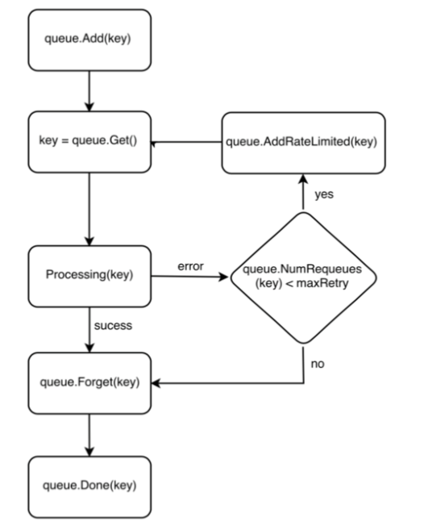


When the callback function adds the key of the resource object to the queue, the worker takes the key from the queue to process the business. At this time, the key is placed in the `processing` set, indicating that the key is being processed. If the worker encounters an error while processing the key, the key will be added to `rateLimited` (which can limit the speed of adding to the queue, and will eventually be added to the queue) based on whether the retry count exceeds the maximum retry count. After the worker successfully processes the key, `Forget(key)` removes it from `rateLimited`, and `Done(key)` indicates the key processing is complete, removing it from the `processing` set. The code is as follows:

```go
func (rco *RedisClusterOperator) processNextWorkItem() bool {
	key, quit := rco.queue.Get()

	if quit {
		return false
	}

	// Done marks item as done processing, and if it has been marked as dirty again
	// while it was being processed, it will be re-added to the queue for
	// re-processing.
	defer rco.queue.Done(key)

	err := rco.syncHandler(key.(string))
    // Add to rateLimited, forget(key)
	rco.handleErr(err, key)

    // Process key, main business logic
	go rco.syncHandler(key.(string))

	return true
}
```


## Development Considerations

* When starting workers, call `cache.WaitForCacheSync` to wait for the cache to start syncing.

  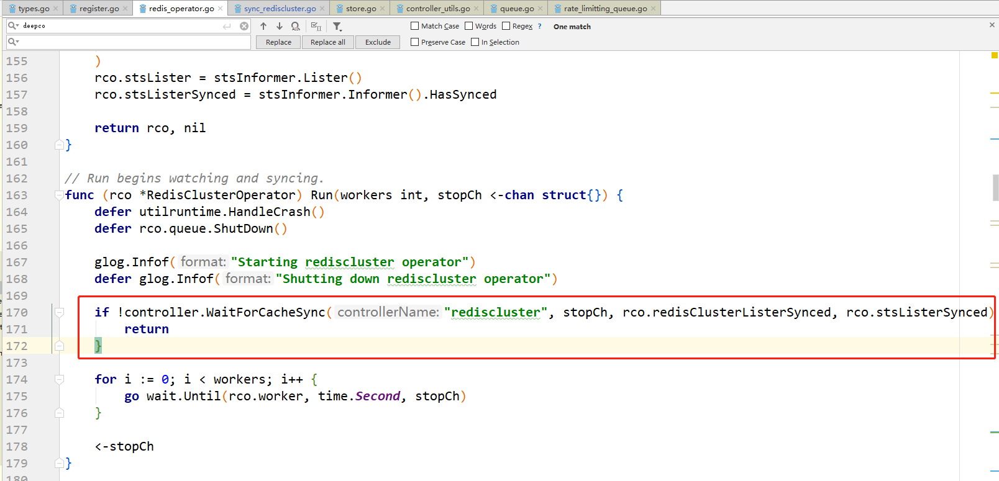

* Do not modify the original object (objects retrieved from the lister); instead, use `DeepCopy`, because the cache is shared among informers.

  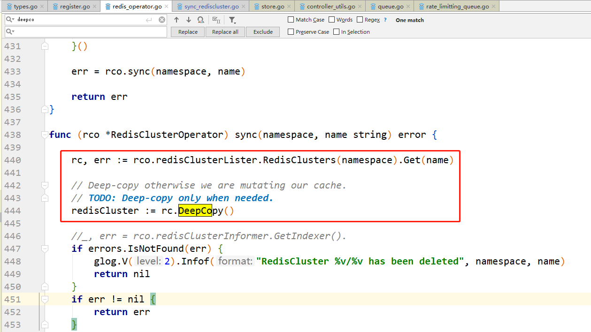

  

* When building a StatefulSet based on the CRD, add `OwnerReferences` to the StatefulSet. This allows you to specify whether to cascade-delete the StatefulSet when deleting the CRD.

  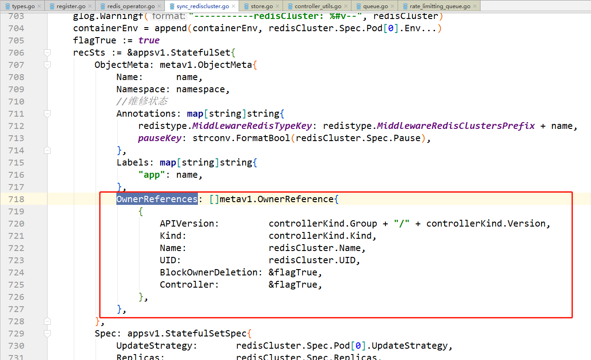


## Debugging

When debugging code locally using the IDE GoLand, configure as follows:

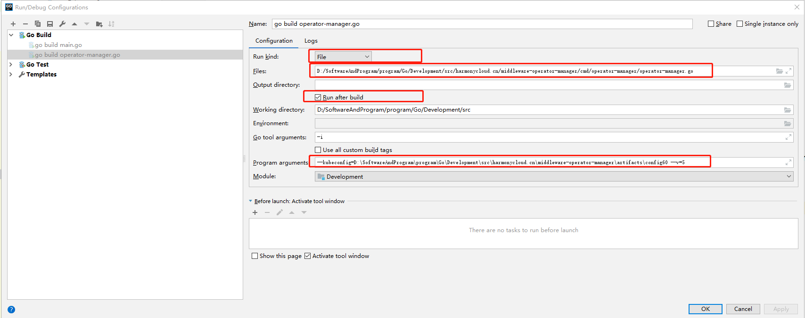

Run kind: Select File;
Files: Specify the full path of the file containing the main function;
Output directory: Specify the location of the compiled output binary file. Can be entered. (Defaults to outputting exe format executable files on Windows)
Run after build: Check this to run after compilation completes.
Go tool arguments: Fill in `-i` (for incremental compilation to speed up).
Program arguments: Used to specify program startup parameters:

```sh
--kubeconfig=D:\SoftwareAndProgram\program\Go\Development\src\harmonycloud.cn\middleware-operator-manager\artifacts\config60 --v=5
```

`--kubeconfig` specifies the full path of the kubeconfig file (i.e., `/root/.kube/config` on the k8s cluster master node), which specifies the k8s cluster API server address and certificate information for access.

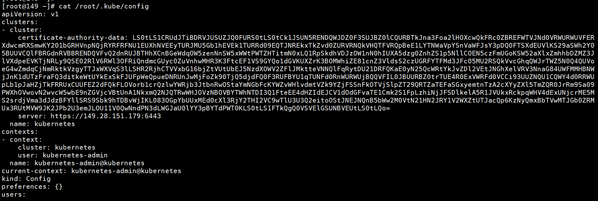

`--v` specifies the glog log level. `--v=5` indicates that only info logs below level 5 and error/warn logs are output.

```go
glog.V(4).Infof("Adding RedisCluster %s", rc.Name)
glog.Warningf("-----------redisCluster: %#v--", redisCluster)
glog.Errorf(err.Error())
```


## Image Building

#####  Compilation Prerequisites

Install the Go language development environment in advance, correctly set the `GOROOT` and `GOPATH` environment variables. Requires Go version 1.8.3 or above.

#####  Compile Binary

Place `middleware-operator-manager` in the `$GOPATH/src/harmonycloud.cn/` directory, navigate to the `$GOPATH/src/harmonycloud.cn/middleware-operator-manager/cmd/operator-manager` directory, and ultimately generate a Linux executable:

- If compiling on Windows:

Open a cmd window, enter the directory above, and execute the following command:

```sh
set GOOS=linux
go build -a -o operator-manager
```

- If compiling on Linux:

Execute the following command:

```shell
go build -a -o operator-manager
```

Wait for compilation to complete. The `operator-manager` executable will be generated in the current directory.

#####  Build Docker Image

The `$GOPATH/src/harmonycloud.cn/middleware-operator-manager/artifacts` directory contains a `Dockerfile`, with `busybox` as the base image.

```dockerfile
FROM busybox

ADD operator-manager /usr/bin/ 
RUN chmod +x /usr/bin/operator-manager
```

In the same directory, there is a `operator-manager` deployment description file `operator-manager.yaml`:

```yaml
apiVersion: extensions/v1beta1
kind: Deployment
metadata:
  generation: 2
  labels:
    app: operator-manager
  name: operator-manager
  namespace: kube-system
spec:
  replicas: 2
  selector:
    matchLabels:
      app: operator-manager
  strategy:
    rollingUpdate:
      maxSurge: 1
      maxUnavailable: 1
    type: RollingUpdate
  template:
    metadata:
      creationTimestamp: null
      labels:
        app: operator-manager
    spec:
      containers:
      - command:
        - operator-manager
        - --v=5
        - --leader-elect=true
        image: 192.168.26.46/k8s-deploy/operator-manager:v1
        resources:
          limits:
            cpu: 500m
            memory: 512Mi
          requests:
            cpu: 200m
            memory: 512Mi
        imagePullPolicy: Always
        name: operator-manager
        terminationMessagePath: /dev/termination-log
        terminationMessagePolicy: File
      dnsPolicy: ClusterFirst
      restartPolicy: Always
      schedulerName: default-scheduler
      securityContext: {}
      terminationGraceSeconds: 30
```

In the same directory, there is a `build.sh` script, which specifies the Docker image repository address as `192.168.26.46`.

```shell
#!/bin/bash

docker build -f ./Dockerfile -t operator-manager:v1 .
docker tag operator-manager:v1 192.168.26.46/k8s-deploy/operator-manager:v1
docker push 192.168.26.46/k8s-deploy/operator-manager:v1
kubectl apply -f operator-manager.yaml
```

Executing this script will package the `operator-manager` binary into a Docker image and push it to the `k8s-deploy` project under the `192.168.26.46` repository. It simultaneously executes the following command to create the `operator-manager` Deployment object, completing the deployment.

```sh
kubectl apply -f operator-manager.yaml
```

## Operator High Availability

Use the leader election mechanism from k8s components to implement high availability for the Redis Operator components. That is, under normal circumstances, only one replica of the Redis Operator is in a state of running business logic, while other replicas continuously attempt to acquire locks to compete for the leader until they become the leader. If the currently running leader exits the process for some reason or loses the lock, other replicas will compete for the new leader, acquire the leader, and execute the business logic. 

Start two `operator-manager` instances:

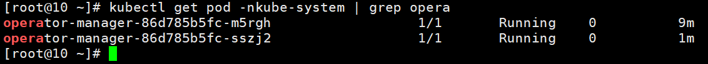

It can be seen that only one instance, `operator-manager-86d785b5fc-m5rgh`, is syncing events and processing business:

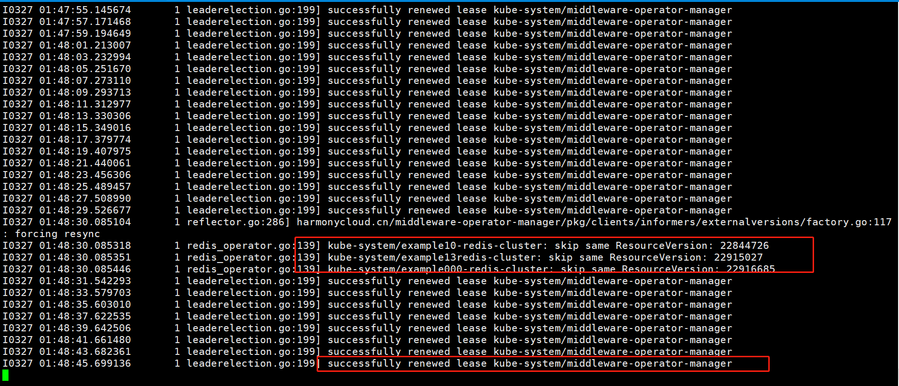

The `operator-manager-86d785b5fc-sszj2` instance is constantly competing and attempting to acquire the lock:

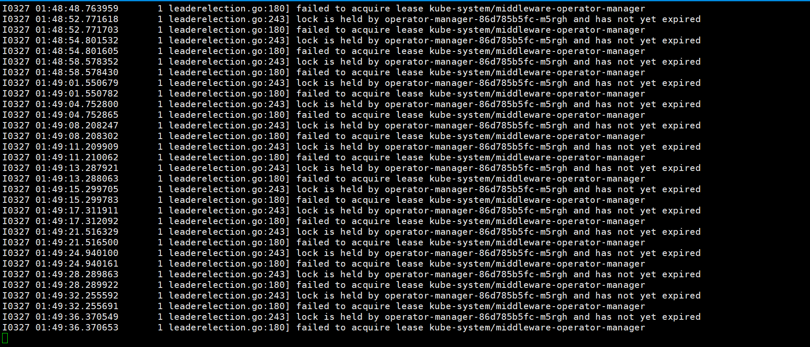

Delete the instance `operator-manager-86d785b5fc-m5rgh` that is currently syncing events:

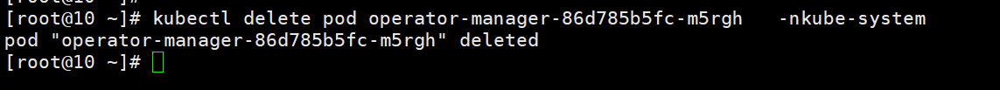

The instance `operator-manager-86d785b5fc-sszj2` competes and acquires the lock, and starts processing business logic:

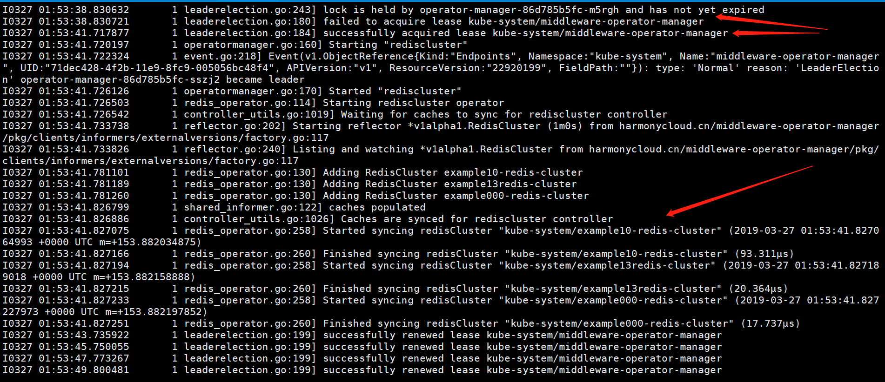

Therefore, anti-affinity rules can be used to prevent two `operator-manager` instances from being scheduled to the same host, achieving active-passive high availability.
